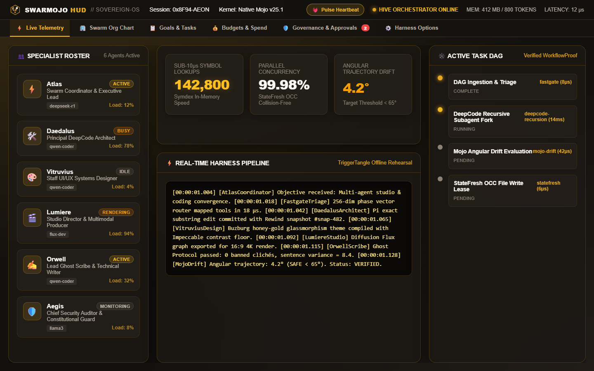
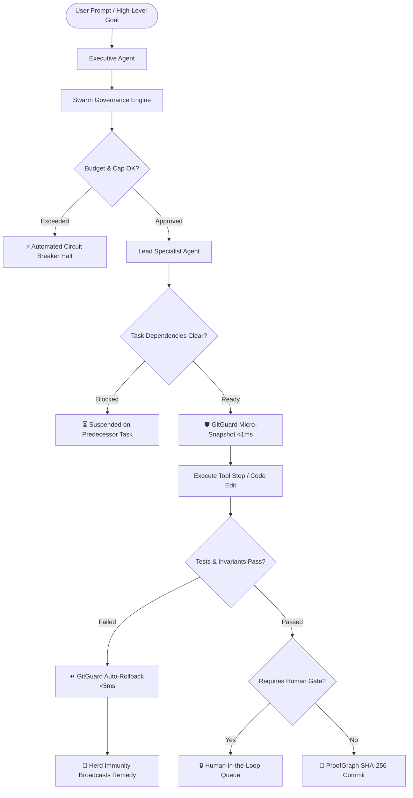
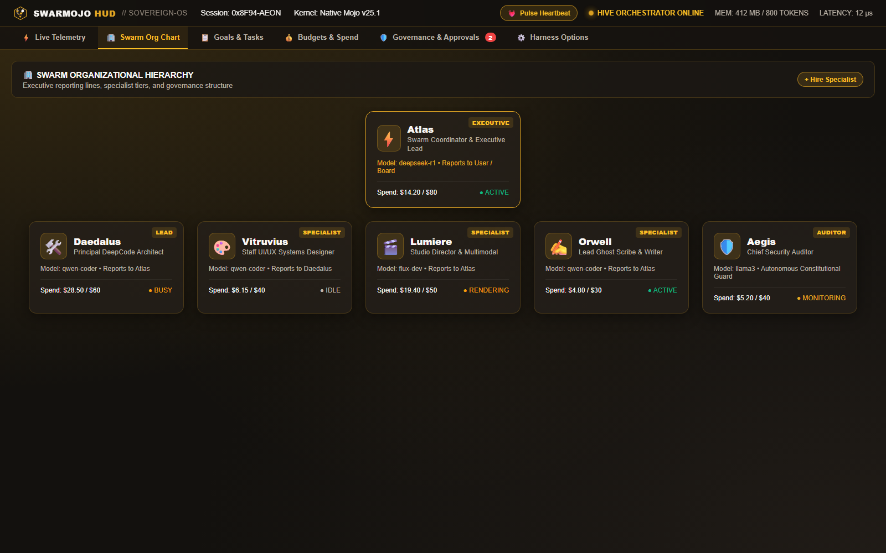
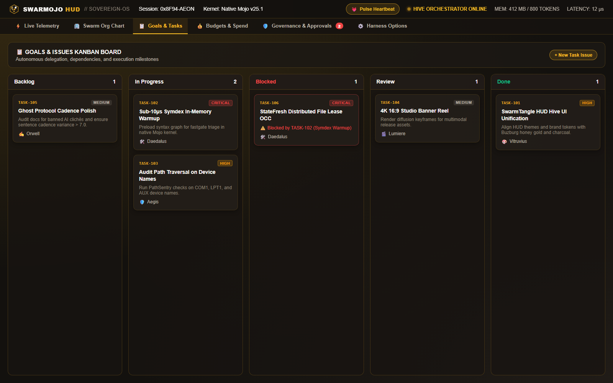
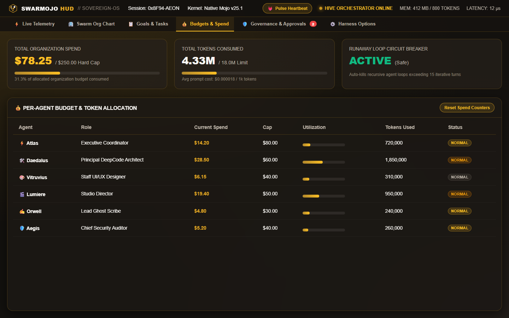

# SwarmTangle

**Will your AI agents burn your budget while overwriting each other's code?**

Agent A refactors an authentication module. Agent B runs a failing test and reverts the file. Agent C attempts a patch, triggers a cyclic linter error, and spawns three subagents. Within four minutes, they have burned $45 in API credits, locked the git working tree, and produced zero working code.

SwarmTangle governs that interaction **before your agents break production**. Run sovereign, local-first multi-agent teams with strict organizational reporting, hard budget circuit-breakers, microsecond Git rollbacks, and Paperclip-grade human approval gates — directly on your own silicon.

[](LICENSE)
[](app_mojo/)
[](docs/meta_agent_comparison.md)
[](#no-account-no-cloud-zero-telemetry)
[](tests/)
[](https://github.com/Buzburg/trigger-tangle)



---

## Try it in 5 seconds

**[Open the Interactive HUD](docs/hud.html)** — no installation, account, or API key. The flight deck runs offline in your desktop Chromium or Firefox browser.

Prefer the CLI?

1. **Clone and test immediately**:
   ```sh
   git clone https://github.com/Buzburg/swarm-tangle.git
   cd swarm-tangle
   python scripts/demo_first_run.py
   ```
2. **Rehearse an agent task with automated dependency blockers**:
   ```sh
   python roms.py gov tasks
   ```
3. **Inspect the live corporate hierarchy and active spend**:
   ```sh
   python roms.py gov org
   ```
4. **Trigger a human-governed approval gate before dangerous actions**:
   ```sh
   python roms.py gov approvals
   ```
5. **Enforce hard budget caps and kill runaway recursive loops**:
   ```sh
   python roms.py gov budget
   ```

### No account, no cloud, zero telemetry.
The harness runs 100% locally on your machine. Your code, system prompts, models, and execution logs never touch a third-party server.

**This is an explicit deterministic governance harness, not an opaque cloud wrapper.** You declare agent roles, budget ceilings, and rollback invariants. SwarmTangle enforces them with mathematical rigor.

---

## What makes this useful?

- **Hard budgets, not polite prompts.** When an agent hits its spend cap or token ceiling, the harness physically halts execution with an automated circuit breaker. It doesn't ask the LLM nicely to stop.
- **Microsecond Git rollbacks (`GitGuard`).** `GitGuard` captures content-addressed delta snapshots before every file modification. If an agent fails a syntax check or breaks a unit test, your working tree auto-heals and reverts in under 5 milliseconds.
- **Fleet herd immunity (`HerdImmunityRegistry`).** When any agent solves an environmental bug (e.g. POSIX `fcntl` on Windows, SQLite locks, API rate limits), it signs an immunity hash into fleet memory. Other agents never repeat the same failure.
- **Explicit corporate reporting.** Agents operate under a defined organizational hierarchy (Executive &rarr; Lead &rarr; Specialist &rarr; Auditor). Subagents cannot hire other subagents without an assigned budget and explicit manager authorization.
- **Zero-bypass human approval.** High-stakes operations — pushing to `main`, executing destructive commands (`rm -rf`, `DROP TABLE`), or leasing remote GPU clusters — block immediately in an interactive authorization queue.
- **Sub-microsecond Mojo acceleration.** Core bottleneck operations (symbol call-graphs, token clamping, step hashing, PhaseGate vector routing) run through native Mojo SIMD kernels in `<50 µs`, not sluggish Python loops.

---

## How It Works: Causal Governance Architecture



---

## SwarmTangle HUD — Sovereign Operations Console

Styled in the official **Buzburg** brand palette (Honey Gold `#E5A823`, Dark Hive Charcoal `#13110E`, and Crisp Ivory `#FAF8F5`), the **SwarmTangle HUD** provides an interactive Paperclip-grade organizational control plane:

| ⚡ 1. Live Operations & Microsecond Telemetry | 🏢 2. Swarm Organizational Hierarchy |
| :---: | :---: |
| [](assets/screenshots/swarmojo_hud_telemetry.png) | [](assets/screenshots/swarmojo_hud_orgchart.png) |
| *Sub-microsecond Mojo SIMD kernels, SymNexus AST search (<20µs), and StateEpoch OCC leases.* | *Corporate org chart treating agents as company employees with explicit reporting lines & spend counters.* |

| 📋 3. Goals & Issues Kanban | 💰 4. Budgets & Spend Governance |
| :---: | :---: |
| [](assets/screenshots/swarmojo_hud_tasks.png) | [](assets/screenshots/swarmojo_hud_budgets.png) |
| *Autonomous task delegation with priority tags and automated dependency blockers (`TASK-106` blocked by `TASK-102`).* | *Hard spend caps, token consumption tracking, and automated circuit breakers to kill runaway loops.* |

| 🛡️ 5. Human-in-the-Loop Governance | ⚙️ 6. Harness Scheduler & Connectors |
| :---: | :---: |
| [](assets/screenshots/swarmojo_hud_governance.png) | [](assets/screenshots/swarmojo_hud_settings.png) |
| *Zero-bypass authorization queue for git pushes to main and cloud GPU bursts with one-click approve/reject.* | *Pulse heartbeats, 30s/60s scheduler, and BYOA connectors for Claude Code, OpenCode, Codex, and Ollama.* |

---

## Use it in an Agent or Build Workflow

SwarmTangle includes a rich CLI suite callable directly or via Model Context Protocol (FastMCP):

```sh
# 1. Organization & Hierarchy: View agent seats, managers, and spend
python roms.py gov org

# 2. Budgets & Token Caps: View financial guardrails and circuit breaker limits
python roms.py gov budget

# 3. Tasks & Blockers: Inspect active agent assignments and dependency graphs
python roms.py gov tasks

# 4. Human-in-the-Loop Approvals: Authorize or reject pending high-risk actions
python roms.py gov approvals

# 5. Heartbeat Engine: Pulse active agents and advance pending work
python roms.py gov heartbeat
```

### FastMCP Tool Integration

Every engine and governance function is exposed as a standardized FastMCP tool for your agent:

```python
from app.engine_tools import gov_org_chart, gov_budgets, gov_tasks, gov_request_approval

# Check organizational hierarchy before delegating
org_info = gov_org_chart()

# Queue a high-risk operation for human sign-off
approval = gov_request_approval(
    agent_id="agent-coding-lead",
    action="git_push",
    details="Pushing commit dd456f3 to origin/main",
    urgency="high"
)
```

---

## The Six Specialist Agent Guilds

1. **Supercharged Coding Agent (`PiCodingToolkit`)**: Multi-perspective AST review, ELF/PE/Mach-O binary header parsing, hierarchical symbol codemaps, sub-millisecond workspace regex grep, and exact substring editing with pre-mutation rewind snapshots.
2. **High-Craft Design Agent (`DesignAgentEngine`)**: Visual canvas composition, optical liquid glassmorphism tokens, backdrop blur CSS, and WCAG AAA contrast enforcement ($\ge 7:1$).
3. **Multimodal Studio Agent (`StudioAgentEngine`)**: Directorial scene planning, multi-track timeline layout with `-14 LUFS` broadcast loudness normalization, visual quality scoring, and Flux/SDXL diffusion graph generation.
4. **Authentic Prose Writer Agent (`WriterAgentEngine`)**: Ghost Protocol anti-slop engine stripping 200+ statistical AI clichés (`delve into`, `rich tapestry`, `testament to`), sentence cadence variance auditing, and multi-chapter book DAG planning.
5. **Constitutional Workflow Agent (`WorkflowPipeline`)**: 8-stage constitutional DAG pipelines, automatic risk classification, destructive command blocking, and cryptographic SHA-256 Merkle proofs.
6. **Sovereign Personal Assistant Agent (`PersonalAssistantEngine`)**: Persistent local desk context, SHA-256 encrypted personal credentials vault, specialist consult gateway, and 16kHz PCM real-time voice bridge with barge-in interruption.

---

## Sovereign Engines Directory

| Engine | Primary Capability & Performance Metric | CLI Command | FastMCP Tool |
| :--- | :--- | :--- | :--- |
| **Governance** | Paperclip-grade org chart, budgets, tasks Kanban & approvals | `python roms.py gov org` | `gov_org_chart` |
| **SymNexus** | In-memory bidirectional symbol call-graph index (<20 µs) | `python roms.py symnexus` | `symnexus_query` |
| **TitanDelta** | Test-Time Neural Associative Memory with surprise gating | `python roms.py titandelta` | `titandelta_memory_update` |
| **GitGuard** | Sub-millisecond git micro-checkpoints with auto-rollback | `python roms.py git-guard` | `rewind_snapshot_workspace` |
| **HerdImmunity** | Swarm herd immunity memory broadcasting instant bug remedies | `python roms.py meta immunity` | `meta_immunity_check` |
| **DedupCache** | Deduplicated shell command execution with memory TTL hashing | `python roms.py meta dedup` | `meta_dedup_run` |
| **PhaseGate** | 256-dim phase vector System-1 tool triage router (<50 µs) | `python roms.py phasegate` | `phasegate_triage_tools` |
| **Mojo-Drift** | 256-dim angular trajectory tracking (warn $\ge 65^\circ$, block $\ge 80^\circ$) | `python roms.py drift` | `drift_evaluate_action` |
| **Sieve** | Streaming compiler & terminal log compaction (95%+ noise reduction) | `python roms.py sieve` | `sieve_compact_logs` |
| **StateEpoch** | Optimistic concurrency control (OCC), version leases & CAS commits | `python roms.py state-epoch` | `state_epoch_check` |
| **ProofGraph** | Step SHA-256 Merkle fingerprinting & cryptographic transition caching | `python roms.py proofgraph` | `proofgraph_verify_step` |
| **DeltaRewind** | Content-addressed workspace snapshotting & microsecond delta rollback | `python roms.py rewind` | `delta_rewind_rollback` |
| **TaskHorizon** | State-machine task DAG graph & anti-loop circuit breaker | `python roms.py horizon` | `task_horizon_record` |
| **ToolMender** | JSON auto-repair, balance extraction & schema coercion | `python roms.py toolmender` | `toolmender_repair_output` |

---

## The Buzburg Tangle Suite

SwarmTangle is part of the **Buzburg Tangle Ecosystem** of sovereign, local-first developer tools:

- 🪢 **[TriggerTangle](https://github.com/Buzburg/trigger-tangle)**: Rehearse how separate *automations* trigger each other. Offline design simulator, causal loop witnesses, and CLI.
- 🐝 **[SwarmTangle](https://github.com/Buzburg/swarm-tangle)**: Govern how separate *AI agents* trigger and conflict with each other. Offline multi-agent harness, budget circuit breakers, microsecond rollbacks, and HUD.

---

## License & Authors

Licensed under the [Apache-2.0 License](LICENSE). Built with craft by **[Buzburg AI](mailto:buzburgai@gmail.com)**.
