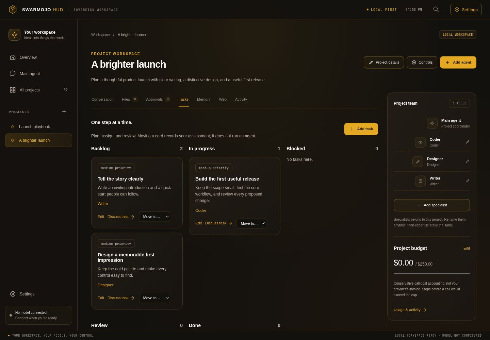

# Swarmojo

**Your ideas. Your agents. Your workspace.**

Turn an idea into a project, bring in the specialists you need, and build with an AI team you control. Swarmojo is a local-first agent workspace with a dedicated Main agent, project memory, ROMS knowledge, and reviewed file and command proposals—all in a warm gold-and-charcoal desktop.

[](https://github.com/Buzburg/Swarmojo/actions/workflows/checks.yml)
[](pyproject.toml)
[](LICENSE)

[Explore the interface](https://buzburg.github.io/Swarmojo/) · [Desktop guide](docs/desktop-features.md) · [Agent runtime](docs/meta-runtime.md) · [Report an issue](https://github.com/Buzburg/Swarmojo/issues)



## Make room for your next idea

- **Start with a project.** Give it a brief, its own workspace, and a team assembled for that job. Your sidebar keeps projects within reach.
- **Choose your specialists.** Choose from 21 roles, including Assistant, Coder, Writer, Designer, Forecaster, Researcher, Director, Marketer, Mathematician, Renigineer, Accountant, Trader, Lawyer, and Adjuster. Rename them, give them project guidance, pause them, and choose per-agent model settings. Their specialist prompts, skills, tools, and memory policies stay intact.
- **Think with your Main agent.** Use a separate everyday conversation for questions, planning, and ideas that don’t belong to one project.
- **Keep useful context close.** Save project notes, search conversations and references, read public web pages, and select excerpts from your existing ROMS knowledge index.
- **Take evidence into your next task.** Select ROMS references in Memory, add a task and constraints, preview the resulting brief, and download it as Markdown. Stale references must be selected again before export.
- **Check data before handing it off.** Local utilities provide an offline CSV comparer and folder/ZIP filename checker. Download either tool and open it locally; your files stay in that browser.
- **Stay in control of changes.** Inspect exact file contents and commands before approving them. Set action permissions, context exclusions, and project budgets. Review receipts and activity as work progresses.
- **Pick up where you left off.** Projects and chats persist locally. Drafts and your last workspace view survive a browser refresh. After a server interruption, restore a request as a draft and decide when to send it again.
- **Take your setup with you.** Export a reusable project template and import it into another Swarmojo workspace. Templates carry the brief, specialist configuration, and controls—not connection keys or conversation history.

## Get started

You need **Python 3.11 or newer**. A virtual environment keeps Swarmojo’s dependencies separate from other projects.

```sh
git clone https://github.com/Buzburg/Swarmojo.git
cd Swarmojo
python -m venv .venv
```

Activate it on Linux or macOS:

```sh
source .venv/bin/activate
```

Or in Windows PowerShell:

```powershell
.venv\Scripts\Activate.ps1
```

Then install and launch:

```sh
python -m pip install .
python swarmmojo.py desktop
```

Open **http://127.0.0.1:8765**. The installed `swarmojo-desktop` command launches the same workspace.

1. Open **Settings** in the top bar and enter your model ID and OpenAI-compatible endpoint. Local HTTP endpoints and remote HTTPS endpoints are supported. No model is preselected.
2. Create a project from the left sidebar. Add a brief and the specialists you want to use.
3. Use each specialist’s **On/Off** switch and choose **Team** or **Isolated**. Select **Work with → Team** for coordinated replies, or open a specialist’s isolated workspace to work with it separately.
4. When changes are proposed, open **Approvals**, review the exact action, and choose whether to apply it.

**Try the interface first:** the [live preview](https://buzburg.github.io/Swarmojo/) needs no installation. It shows the design; saving projects, connecting models, and running agents require your local server.

## A workspace that remembers

| Section | What you can do |
| --- | --- |
| Conversation | Talk with Main, run your active team, or work with an isolated specialist |
| Tasks | Assign owners, set priorities and dependencies, and track your assessment of progress |
| Memory | Curate notes, search project history, and explicitly select ROMS knowledge excerpts |
| Web | Read public HTML or text pages and choose saved references for model context |
| Files | See files in the project workspace |
| Approvals | Review proposed writes and commands, then inspect their receipts |
| Activity | Review runs, changes to settings, and conservative usage accounting |
| Controls | Set allowed actions, shared context, ignored paths, and a lifetime project budget |

Use **Ctrl+K / Cmd+K** for quick navigation and **Ctrl+, / Cmd+,** for Settings. Templates are available in project Memory and Workspace settings.

Swarmojo now includes the ROMS 1.4 knowledge layer: one local Q8 retrieval backend, richer document intake, source-derived skills, bounded task-skill drafting, and portable task briefs. The desktop searches an existing local ROMS index on request. Selected excerpts become project reference snapshots; they do not grant permission to execute actions.

For full knowledge indexing and task-skill authoring, see [ROMS setup and upgrades](docs/roms-integration.md). The [repository review](docs/repository-review.md) records which Buzburg projects were added, already present, or deferred.

## Your models, your choices

Swarmojo can use a local model or your chosen remote provider. The desktop starts disconnected. API keys entered in Settings stay in server-process memory and need to be supplied again after a restart. You can also set `SWARMOJO_MODEL_API_KEY` in the server’s environment.

Project data is stored on your machine, by default under `~/.local/state/swarmojo/desktop/`. Use `swarmojo-desktop --state-dir PATH --port 8765` for a different state directory. When you choose a remote provider, your messages and selected context are sent to that provider. Reading a public page contacts that site.

The public-page reader retrieves text without scripts, cookies, or login sessions. It accepts public HTTP(S) addresses on ports 80/443, limits page size, and rejects private network destinations. It is designed for reference reading, not interactive web automation.

## Practical boundaries

- **Approval is explicit.** Generating a response does not execute a file write or command. Existing approvals are checked against current project permissions and the reviewed target state.
- **Commands need a sandbox.** Desktop command execution requires Linux with `bubblewrap` available. On other platforms, use discussion and file proposals; command execution fails closed when its sandbox is unavailable.
- **Budgets use configured bounds.** Monetary accounting uses the maximum cost per model call that you enter, rather than a provider invoice. Set a realistic bound for paid models. Existing per-agent limits also apply.
- **Task cards are planning records.** Moving a task does not run an agent or prove a result is correct. A team run gathers specialist replies and then a coordinator response.
- **Recovery does not replay work.** Saved replies and approvals remain available after interruption. Requests are restored only as editable drafts.
- **Mojo is optional for the desktop.** Native kernels and other advanced CLI features have their own runtime requirements. No native speed benchmark is implied by the desktop experience.

See the [desktop guide](docs/desktop-features.md) for context limits, portable template contents, and recovery behavior.

## Build on the harness

Swarmojo also ships Python, CLI, and MCP interfaces for agent workflows. The desktop uses the existing specialist runtime, governance ledger, and approval store. MCP starts with a read-only tool profile, bounded requests, and custom plugins disabled. See [MCP access controls](docs/mcp-security.md) to enable the capabilities you need.

```sh
python swarmmojo.py --help
python swarmmojo.py gov org
python scripts/demo_first_run.py
```

The last command runs a no-install fixture demonstration. It does not call a live model. For integration contracts and examples, read the [harness interface](docs/HARNESS.md), [runtime guide](docs/meta-runtime.md), and [architecture overview](docs/meta_agent_comparison.md).

To run the portable desktop checks from a source checkout:

```sh
python -m pip install -r requirements-ci.txt
python -m pytest tests/test_desktop.py tests/test_desktop_release.py -q
```

After editing `app/desktop_assets/`, run `python scripts/sync_desktop_preview.py` to refresh the GitHub Pages preview. CI checks the desktop alongside the portable harness on Linux and Windows with Python 3.11 and 3.12.

## Contribute

Have an idea for a better agent workflow? Open an issue with the result you want to achieve. For a bug, include your operating system, Python version, reproduction steps, and redacted logs. Keep credentials and private project content out of reports.

Built by **[Buzburg AI](mailto:buzburgai@gmail.com)**. Licensed under [Apache-2.0](LICENSE); see [NOTICE](NOTICE) for retained third-party notices.
